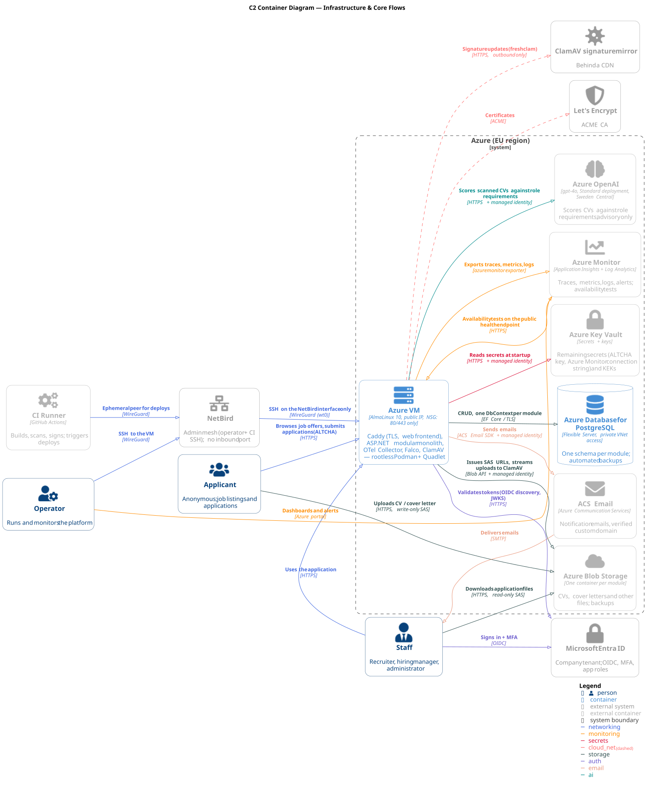

# Architecture Description Document (ADD)

> ISO/IEC/IEEE 42010 — Architecture Description.
> This document is the index and overview of the HealthyHires architecture. It identifies stakeholders and concerns, defines the system's scope, records the binding constraints and quality attributes, and points to every detailed architecture view.
>
> Detailed views, decisions and evidence live in their own documents.

## 1. System Identification

| Field | Value |
| ----- | ----- |
| System name | HealthyHires |
| Document owner | Architecture (`@architecture`) |
| Versioning | Versioned in git |
| Status | Living document. |

## 2. Purpose

HealthyHires is a **talent acquisition** application built for a single company's internal use. It publishes the company's job offers and collects applications from candidates, and lets the company's staff manage those offers and applications.

It serves two groups of users:

- **Applicants (anonymous)** — members of the public with no account and no login. They can browse job listings and apply to a job offer by uploading a CV and a cover letter.
- **Staff (authenticated)** — company employees who sign in with their work account through Microsoft Entra ID ([ADR-004](ADR.md#adr-004-identity-provider--microsoft-entra-id-oidc)). Their roles are **recruiter**, **hiring manager** and **administrator**, assigned as Entra app roles. Accounts are pre-created by the company; there is no self-registration.

The product is delivered as a single modular monolith backend ([ADR-A001](ADR-ASPNET.md#adr-a001-application-architecture--modular-monolith)) hosted on Azure ([ADR-001](ADR.md#adr-001-hosting-platform--azure-vm)) and used **only through web browsers**; there are no mobile or desktop clients.

The system context and container views are shown below; their PlantUML sources live in [docs/diagrams/architecture](../diagrams/architecture) and are rendered with `scripts/render-diagrams.sh`.

Further views:

- [C1 Supply Chain](../diagrams/architecture/C1_Supply_Chain.svg) — source → signed images → deploy to the VM.
- [C2 VM Containers](../diagrams/architecture/C2_vm_containers.svg) — Podman containers and host services inside the Azure VM.
- [C3 Telemetry Pipeline](../diagrams/architecture/C3_telemetry_pipeline.svg) — signals, the OpenTelemetry Collector, Azure Monitor and alerting.

## 3. Scope

### 3.1 In Scope

- ASP.NET modular monolith API (see [ADR-ASPNET.md](ADR-ASPNET.md), [ADR-A001](ADR-ASPNET.md#adr-a001-application-architecture--modular-monolith)).
- React web client, used only through web browsers (see [ADR-FRONTEND.md](ADR-FRONTEND.md)).
- Hosting on a single Azure VM running AlmaLinux 10 with rootless Podman and Caddy as the public edge ([ADR-001](ADR.md#adr-001-hosting-platform--azure-vm), [ADR-002](ADR.md#adr-002-container-runtime--podman-rootless-where-possible), [ADR-003](ADR.md#adr-003-edge--reverse-proxy--caddy), [ADR-015](ADR.md#adr-015-operating-system--almalinux-10)).
- Staff identity via the company's Microsoft Entra ID tenant with app roles; applicants stay anonymous ([ADR-004](ADR.md#adr-004-identity-provider--microsoft-entra-id-oidc)).
- PostgreSQL persistence ([ADR-006](ADR.md#adr-006-primary-database--postgresql-managed), [ADR-A005](ADR-ASPNET.md#adr-a005-persistence--postgresql-with-entity-framework-core)).
- Blob Storage for CVs, cover letters and backups, with direct browser uploads and downloads and ClamAV malware scanning ([ADR-005](ADR.md#adr-005-object-storage--azure-blob-storage), [ADR-A010](ADR-ASPNET.md#adr-a010-file-storage--azure-blob-storage-via-azure-sdk)).
- Abuse protection for the public application form: ALTCHA and per-IP rate limiting ([ADR-022](ADR.md#adr-022-bot-protection--altcha-on-the-application-form), [ADR-A007](ADR-ASPNET.md#adr-a007-rate-limiting--aspnet-core-rate-limiting)).
- Observability via Azure Monitor + OpenTelemetry, with an OpenTelemetry Collector sidecar and external availability tests ([ADR-007](ADR.md#adr-007-observability--azure-monitor--opentelemetry), [ADR-007.1](ADR.md#adr-0071-telemetry-pipeline--opentelemetry-collector-otelcol-contrib), [ADR-016](ADR.md#adr-016-external-uptime-probe--application-insights-availability-tests)).
- Security tooling: Trivy, OpenSCAP, AIDE, Cosign ([ADR-008](ADR.md#adr-008-security--supply-chain-tools--trivy-openscap-aide-cosign)), OWASP ZAP ([ADR-020](ADR.md#adr-020-dynamic-application-security-testing--owasp-zap)) and auditd ([ADR-017](ADR.md#adr-017-auditd-rule-scope--cis-baseline-with-documented-deviations)).
- Runtime container security via Falco ([ADR-011](ADR.md#adr-011-runtime-container-security--falco)).
- Test tooling: Schemathesis for contracts, Playwright for end-to-end, k6 for load, Toxiproxy for fault injection ([ADR-009](ADR.md#adr-009-api-testing--contract-validation--schemathesis), [ADR-019](ADR.md#adr-019-end-to-end-testing--playwright), [ADR-018](ADR.md#adr-018-load-and-performance-testing--k6), [ADR-021](ADR.md#adr-021-fault-injection--toxiproxy)).
- Secrets in Azure Key Vault, read via the VM's managed identity; Key Encryption Keys (KEK) in Key Vault for envelope encryption ([ADR-012](ADR.md#adr-012-secrets-store--azure-key-vault), [ADR-013](ADR.md#adr-013-key-management-kek--azure-key-vault)).
- Operator and CI access over the NetBird admin mesh ([ADR-014](ADR.md#adr-014-admin-access--netbird-operator-and-ci-runner-ssh)).
- Email delivery via Azure Communication Services ([ADR-010](ADR.md#adr-010-email-delivery--azure-communication-services-email)).
- CV scoring against the role's requirements with Azure OpenAI, as an advisory ranking for HR ([ADR-024](ADR.md#adr-024-cv-scoring--azure-openai-gpt-4o-sweden-central)).

### 3.2 Out of Scope

| Topic | Reason |
| ----- | ------ |
| Kubernetes / managed orchestration | Explicitly excluded by [ADR-001](ADR.md#adr-001-hosting-platform--azure-vm). |
| Mobile and desktop clients | The application is used only through web browsers ([§2](#2-purpose)). |
| Applicant accounts and staff self-registration | Applicants stay anonymous; staff accounts are pre-created in Entra ID ([ADR-004](ADR.md#adr-004-identity-provider--microsoft-entra-id-oidc)). |
| Operating our own SMTP relay | We use Azure Communication Services ([ADR-010](ADR.md#adr-010-email-delivery--azure-communication-services-email)). |
| CDN / WAF in front of the application | Caddy is the public edge ([ADR-003](ADR.md#adr-003-edge--reverse-proxy--caddy)). |
| Multi-region application deployment | Single VM in a single EU region by design ([ADR-001](ADR.md#adr-001-hosting-platform--azure-vm)). |
| GDPR compliance processes | Not in the scope of this school project. |

## 4. Stakeholders and Concerns

| Role / Team Handle | Concerns |
| ------------------ | -------- |
| **Development** — `@devops`, `@architecture` | Velocity, code quality, build & deploy pipeline, ADR hygiene. |
| **Operations / Platform** — `@platform` | Hosting, uptime, scaling, Azure cost discipline, runbooks, capacity planning. |
| **Security** — `@security` | Threat modelling, supply-chain integrity, image signing, bot protection, malware scanning of uploads, secret hygiene, dependency scanning. |
| **Auth** — `@auth` | Entra ID integration, app roles, token lifecycle, MFA, audit. |
| **Data** — `@data` | Database performance, schema evolution, backup/restore, retention, data quality. |
| **Observability** — `@obs` | Metrics, logs, traces, SLOs, alert noise. |
| **Test / QA** — `@tester` | End-to-end and contract coverage, test data, flaky-suite hygiene, release gates. |
| **SRE** — `@sre` | Failure modes, resilience testing, capacity and load, health and readiness contracts. |
| **Product** — `@product` | Feature roadmap, UX, hiring workflow. |
| **Management** — `@management` | Vendor contracts, compliance posture. |
| **Finance** — `@finance` | Azure spend and cost forecasting. |
| **Applicants** (anonymous) | Easy job browsing, simple and reliable CV and cover letter upload, confirmation that an application was received. |
| **Staff** (recruiters, hiring managers, administrators) | Sign-in with their work account, efficient application review, role-based access, safe-to-open applicant files, data correctness. |

> **Note:** Many roles are currently represented by one person.

---

## 5. Architecture Viewpoints

The detailed architecture is organised into the following viewpoints. Each has a dedicated document; this section is the index. Documents marked **TODO** are planned but not written yet, so their names are not linked.

| Viewpoint | Document | Status | Purpose |
| --------- | -------- | ------ | ------- |
| System context (C1) | [system-context.md](system-context.md), [C1 System Context](../diagrams/architecture/C1_System_Context.svg) | Available | Actors, system boundary, external dependencies. |
| Container (C2) | [C2 Containers](../diagrams/architecture/C2_Containers.svg) | Available | Containers, processes, data stores, protocols. |
| Deployment | [container-deployment.md](container-deployment.md), [C2 VM Containers](../diagrams/architecture/C2_vm_containers.svg) | Available | How containers map to the Azure VM, Podman and Quadlet. |
| Data | `data-architecture.md` | TODO | Logical and physical data model, schema per module ([ADR-A001](ADR-ASPNET.md#adr-a001-application-architecture--modular-monolith)), retention. |
| API | `api-architecture-integration.md` | TODO | API style, contracts, versioning, integration patterns ([ADR-A004](ADR-ASPNET.md#adr-a004-api-style--rest-openapi-scalar-and-versioning)). |
| Development | [C1 Supply Chain](../diagrams/architecture/C1_Supply_Chain.svg); [development-architecture.md](development-architecture.md) | Available | Source layout, build, test, release pipeline. |
| Security | `security-architecture.md`, `threat-model.md` | TODO | Defence in depth, threat model, image signing ([ADR-008](ADR.md#adr-008-security--supply-chain-tools--trivy-openscap-aide-cosign)), Falco ([ADR-011](ADR.md#adr-011-runtime-container-security--falco)), Key Vault secrets and KEK ([ADR-012](ADR.md#adr-012-secrets-store--azure-key-vault), [ADR-013](ADR.md#adr-013-key-management-kek--azure-key-vault)), bot protection ([ADR-022](ADR.md#adr-022-bot-protection--altcha-on-the-application-form)). |
| Identity & Access | [iam.md](iam.md) | Available | Entra ID for staff with app roles ([ADR-004](ADR.md#adr-004-identity-provider--microsoft-entra-id-oidc)), anonymous applicant access, managed identity for Azure services. |
| Observability | [C3 Telemetry Pipeline](../diagrams/architecture/C3_telemetry_pipeline.svg); [observability-architecture.md](observability-architecture.md) | Available | Azure Monitor + OpenTelemetry pipelines, alerts, SLOs ([ADR-007](ADR.md#adr-007-observability--azure-monitor--opentelemetry), [ADR-007.1](ADR.md#adr-0071-telemetry-pipeline--opentelemetry-collector-otelcol-contrib)). |
| Infrastructure & Ops | [infrastructure-operations-architecture.md](infrastructure-operations-architecture.md) | Available | Provisioning with Bicep ([ADR-023](ADR.md#adr-023-infrastructure-as-code--bicep)), environments, patching, drift, admin access ([ADR-014](ADR.md#adr-014-admin-access--netbird-operator-and-ci-runner-ssh)). |
| Backup & Recovery | `backup-recovery-plan.md` | TODO | RPO/RTO, restore drills for PostgreSQL and Blob Storage. |
| Compliance | — | Out of scope | GDPR and ISO/SOC mapping are not part of this school project ([§3.2](#32-out-of-scope)). |
| Service inventory | — | Out of scope | Not needed for a single-VM deployment; the C2 diagrams list every service. |
| Decisions | [ADR.md](ADR.md), [ADR-ASPNET.md](ADR-ASPNET.md), [ADR-FRONTEND.md](ADR-FRONTEND.md) | Available | Architecture Decision Records — the "why" behind every choice. |

### 5.1 Security & Privacy Viewpoints (ISMS-aligned)

This school project does not run a formal Information Security Management System (ISMS) or privacy programme. The tables below map ISMS-style concerns to where this architecture addresses them. Documents marked **TODO** are planned but not written yet, so their names are not linked.

| Concern | Architecture view | Status | Owner |
| ------- | ----------------- | ------ | ----- |
| Governance & scope | — | Out of scope | `@security` |
| Information security policy | — | Out of scope | `@security` |
| Risk management | `threat-model.md` | TODO | `@security` |
| Statement of Applicability | — | Out of scope | `@security` |
| Asset inventory | [C2 Containers](../diagrams/architecture/C2_Containers.svg), [C2 VM Containers](../diagrams/architecture/C2_vm_containers.svg) | Covered by diagrams | `@security` |
| Information classification | — | Out of scope | `@security` |
| Access control | [iam.md](iam.md); Entra ID app roles ([ADR-004](ADR.md#adr-004-identity-provider--microsoft-entra-id-oidc)), NetBird admin access ([ADR-014](ADR.md#adr-014-admin-access--netbird-operator-and-ci-runner-ssh)) | Available | `@security`, `@auth`, `@platform` |
| Cryptography | TLS via Caddy ([ADR-003](ADR.md#adr-003-edge--reverse-proxy--caddy)), Key Vault secrets and KEK ([ADR-012](ADR.md#adr-012-secrets-store--azure-key-vault), [ADR-013](ADR.md#adr-013-key-management-kek--azure-key-vault)), encryption at rest ([ADR-005](ADR.md#adr-005-object-storage--azure-blob-storage)) | Decided in ADRs | `@security` |
| Physical & environmental | *(covered by Azure managed services; no on-prem footprint)* | Covered by Azure | — |
| Operations security | Azure Monitor + OpenTelemetry ([ADR-007](ADR.md#adr-007-observability--azure-monitor--opentelemetry)), Falco ([ADR-011](ADR.md#adr-011-runtime-container-security--falco)), auditd ([ADR-017](ADR.md#adr-017-auditd-rule-scope--cis-baseline-with-documented-deviations)); [infrastructure-operations-architecture.md](infrastructure-operations-architecture.md) | Decided in ADRs, document available | `@obs`, `@platform` |
| Communications security | TLS via Caddy, NSG allows only 80/443 ([ADR-003](ADR.md#adr-003-edge--reverse-proxy--caddy)), bot protection ([ADR-022](ADR.md#adr-022-bot-protection--altcha-on-the-application-form)) | Decided in ADRs | `@platform` |
| System acquisition & dev | Supply chain ([ADR-008](ADR.md#adr-008-security--supply-chain-tools--trivy-openscap-aide-cosign), [C1 Supply Chain](../diagrams/architecture/C1_Supply_Chain.svg)); [development-architecture.md](development-architecture.md) | Decided in ADRs, document available | `@devops`, `@security` |
| Personnel security & awareness | — | Out of scope | `@management`, `@security` |
| Supplier relationships | — | Out of scope | `@management` |
| Incident management | — | Out of scope | `@security` |
| Business continuity | `backup-recovery-plan.md` | TODO | `@platform` |
| Vulnerability management | Trivy, OpenSCAP, AIDE, Cosign ([ADR-008](ADR.md#adr-008-security--supply-chain-tools--trivy-openscap-aide-cosign)), OWASP ZAP ([ADR-020](ADR.md#adr-020-dynamic-application-security-testing--owasp-zap)), ClamAV upload scanning ([ADR-A010](ADR-ASPNET.md#adr-a010-file-storage--azure-blob-storage-via-azure-sdk)) | Decided in ADRs | `@security` |

Privacy and GDPR compliance are out of scope for this school project ([§3.2](#32-out-of-scope)).

| Privacy concern | Architecture view | Status | Owner |
| --------------- | ----------------- | ------ | ----- |
| Privacy programme & policy | — | Out of scope | `@security` |
| Data processing inventory (ROPA) | — | Out of scope | `@security` |
| Data retention | — | Out of scope | `@security`, `@data` |
| Data subject requests | — | Out of scope | `@security` |
| Personal-data breaches | — | Out of scope | `@management`, `@security` |
| Privacy impact assessment | — | Out of scope | `@management`, `@security` |
| Cross-border data transfers | All services run in an EU Azure region ([ADR-001](ADR.md#adr-001-hosting-platform--azure-vm)); no formal transfer assessment. | Out of scope | `@security` |

---

## 6. Constraints and Quality Attributes

### 6.1 Binding Constraints

#### Compliance & Data Protection

All data must stay in EU regions: every Azure resource runs in an EU region ([ADR-001](ADR.md#adr-001-hosting-platform--azure-vm), [ADR-005](ADR.md#adr-005-object-storage--azure-blob-storage), [ADR-006](ADR.md#adr-006-primary-database--postgresql-managed)), ACS Email uses the Europe data location ([ADR-010](ADR.md#adr-010-email-delivery--azure-communication-services-email)), and Azure OpenAI uses a Standard deployment, which processes data only in Sweden Central ([ADR-024](ADR.md#adr-024-cv-scoring--azure-openai-gpt-4o-sweden-central)). GDPR compliance processes are out of scope for this school project ([§3.2](#32-out-of-scope)).

#### Security & Governance

No formal ISMS is run ([§5.1](#51-security--privacy-viewpoints-isms-aligned)). The third-party services the system depends on are Microsoft Azure and Entra ID, GitHub, NetBird, Let's Encrypt and the ClamAV signature mirror; no formal supplier assessment is done for them.

#### Infrastructure & Deployment

No Kubernetes is permitted ([ADR-001](ADR.md#adr-001-hosting-platform--azure-vm)). The deployment is a single Azure VM with no orchestrator; only Podman is used ([ADR-002](ADR.md#adr-002-container-runtime--podman-rootless-where-possible)).

The backend is a modular monolith ([ADR-A001](ADR-ASPNET.md#adr-a001-application-architecture--modular-monolith)): one deployable API with independent modules, not microservices.

The project runs on a student budget: paid services are avoided where a free or self-hosted option exists (e.g. ClamAV instead of Defender for Storage).

#### Clients & Integration

The only client is a React web application used through web browsers; there are no mobile or desktop clients ([§2](#2-purpose), [ADR-F001](ADR-FRONTEND.md#adr-f001-application-platform--react-typescript-and-vite)).

Supply-chain integrity is enforced through Trivy + Cosign in CI, with signed images in production. OpenSCAP checks host configuration compliance against the AlmaLinux 10 CIS Level 1 Server baseline ([ADR-008](ADR.md#adr-008-security--supply-chain-tools--trivy-openscap-aide-cosign)).

API contracts are validated by Schemathesis against the OpenAPI document ([ADR-009](ADR.md#adr-009-api-testing--contract-validation--schemathesis)).

### 6.2 Quality Attributes (with measurable targets)

| Attribute | Target | Measured via |
| --------- | ------ | ------------ |
| Availability — **application** | **99 %** monthly for job listings, applications and the staff UI. Depends on the single VM ([ADR-001](ADR.md#adr-001-hosting-platform--azure-vm)); staff sign-in additionally depends on Microsoft Entra ID. | Application Insights availability tests ([ADR-016](ADR.md#adr-016-external-uptime-probe--application-insights-availability-tests)). Sign-in is not probed, because MFA blocks scripted logins. |
| RPO / RTO | **RPO ≤ 1 h**, **RTO ≤ 4 h** for the primary database. | `backup-recovery-plan.md` (TODO), at least one restore drill from PostgreSQL point-in-time backups. |
| P95 API latency | **≤ 300 ms** for read endpoints, **≤ 600 ms** for writes (EU clients). File transfers are excluded, since they go directly to Blob Storage. | OpenTelemetry traces → Application Insights ([ADR-007](ADR.md#adr-007-observability--azure-monitor--opentelemetry)). |
| Upload processing | An uploaded CV or cover letter is scanned and visible to HR within **≤ 1 min**. | Application telemetry on upload confirmation and ClamAV scan duration. |
| Security | **0** Critical/High Trivy findings on production images; **0** OpenSCAP `fail`, `error` or `notchecked` results after applying the approved CIS Level 1 Server tailoring. | CI gate + scheduled OpenSCAP run on the VM ([ADR-008](ADR.md#adr-008-security--supply-chain-tools--trivy-openscap-aide-cosign)). |
| Cost discipline | Monthly Azure spend stays within the project budget. | Azure Cost Management budget with alerts. |
| Maintainability | Time to first commit for a new dev **≤ 1 day**; CI green on main within **≤ 15 min**. | Onboarding runbook, pipeline metrics. |
| Scalability | Handle **10×** the expected load (staff and peak applicant traffic) on the single VM before vertical scaling is required. | k6 load tests ([ADR-018](ADR.md#adr-018-load-and-performance-testing--k6)). |
| EU data residency | **100 %** of application data stored and processed in EU regions. | Azure Policy "allowed locations" restricted to EU regions. |

> **TODO:** The numeric targets above are starting values. Replace with measured baselines after the first load tests and a month of production telemetry, then iterate.

---

## 7. Cross-Cutting Concerns

### 7.1 Security & Privacy

- No formal ISMS or privacy programme is run; see [§5.1](#51-security--privacy-viewpoints-isms-aligned) for the mapping of concerns and what is out of scope.
- Technical controls: Entra ID OIDC with app roles ([ADR-004](ADR.md#adr-004-identity-provider--microsoft-entra-id-oidc), [iam.md](iam.md)); TLS via Caddy, encryption at rest and Key Vault secrets and keys ([ADR-003](ADR.md#adr-003-edge--reverse-proxy--caddy), [ADR-012](ADR.md#adr-012-secrets-store--azure-key-vault), [ADR-013](ADR.md#adr-013-key-management-kek--azure-key-vault)); vulnerability management via Trivy + OpenSCAP + Cosign ([ADR-008](ADR.md#adr-008-security--supply-chain-tools--trivy-openscap-aide-cosign)) and ZAP ([ADR-020](ADR.md#adr-020-dynamic-application-security-testing--owasp-zap)); logging and monitoring via Azure Monitor, Falco and auditd ([ADR-007](ADR.md#adr-007-observability--azure-monitor--opentelemetry), [ADR-011](ADR.md#adr-011-runtime-container-security--falco), [ADR-017](ADR.md#adr-017-auditd-rule-scope--cis-baseline-with-documented-deviations)).
- Public application form: ALTCHA and per-IP rate limiting ([ADR-022](ADR.md#adr-022-bot-protection--altcha-on-the-application-form), [ADR-A007](ADR-ASPNET.md#adr-a007-rate-limiting--aspnet-core-rate-limiting)); uploads go directly to Blob Storage through short-lived SAS URLs and are scanned by ClamAV before staff can open them ([ADR-A010](ADR-ASPNET.md#adr-a010-file-storage--azure-blob-storage-via-azure-sdk)).
- Third parties: Microsoft Azure and Entra ID, GitHub, NetBird, Let's Encrypt and the ClamAV signature mirror; no formal supplier assessment is done.
- Threat model in `threat-model.md` (TODO).
- Defence in depth: edge (Caddy TLS, NSG allowing only 80/443, ALTCHA, rate limiting), app (OWASP baseline, ASP.NET hardening), data (encryption at rest and in transit, managed identity instead of stored keys), supply chain (Trivy + Cosign + signed images), host (OpenSCAP against the CIS baseline, AIDE, auditd, Falco), admin access (NetBird, no public SSH — [ADR-014](ADR.md#adr-014-admin-access--netbird-operator-and-ci-runner-ssh)).

### 7.2 Observability

- Three signals (metrics, logs, traces) via OpenTelemetry → OpenTelemetry Collector → Azure Monitor ([ADR-007](ADR.md#adr-007-observability--azure-monitor--opentelemetry), [ADR-007.1](ADR.md#adr-0071-telemetry-pipeline--opentelemetry-collector-otelcol-contrib)), shown in [C3 Telemetry Pipeline](../diagrams/architecture/C3_telemetry_pipeline.svg).
- External availability tests from Application Insights ([ADR-016](ADR.md#adr-016-external-uptime-probe--application-insights-availability-tests)).
- How the targets are measured, the alert set and where audit trails land are in [observability-architecture.md](observability-architecture.md).

### 7.3 Cost

- The project runs on a student budget; free tiers and self-hosted options are preferred over paid services (e.g. ClamAV instead of Defender for Storage).
- Spend is tracked with an Azure Cost Management budget and alerts.
- Every new paid service must state its cost in its ADR.

### 7.4 Data Protection

- Data model in `data-architecture.md` (TODO); each module owns its own PostgreSQL schema and blob container ([ADR-A001](ADR-ASPNET.md#adr-a001-application-architecture--modular-monolith), [ADR-A010](ADR-ASPNET.md#adr-a010-file-storage--azure-blob-storage-via-azure-sdk)).
- Encryption at rest (managed PostgreSQL + Blob Storage), TLS in transit, secrets in Key Vault, and managed identity for all Azure services, so no access keys are stored.
- Unconfirmed uploads are deleted after one hour and infected files immediately ([ADR-A010](ADR-ASPNET.md#adr-a010-file-storage--azure-blob-storage-via-azure-sdk)). Retention of applicant data is not defined, as GDPR processes are out of scope ([§3.2](#32-out-of-scope)).

### 7.5 API & Integration

- API contract tested by Schemathesis ([ADR-009](ADR.md#adr-009-api-testing--contract-validation--schemathesis)) and scanned dynamically by ZAP ([ADR-020](ADR.md#adr-020-dynamic-application-security-testing--owasp-zap)).
- Integrations: Entra ID, Blob Storage, ACS Email, Azure OpenAI, Key Vault and ClamAV, each with its own failure modes and quotas; outbound calls use the resilience pipeline ([ADR-A011](ADR-ASPNET.md#adr-a011-resilience--microsoftextensionsresilience)) and commands are protected by idempotency keys ([ADR-A016](ADR-ASPNET.md#adr-a016-idempotency--idempotency-key-middleware)).

### 7.6 Operations

- Deployment topology in [container-deployment.md](container-deployment.md) and [C2 VM Containers](../diagrams/architecture/C2_vm_containers.svg).
- Provisioning with Bicep ([ADR-023](ADR.md#adr-023-infrastructure-as-code--bicep)), patching and drift in [infrastructure-operations-architecture.md](infrastructure-operations-architecture.md); admin access over NetBird, with Azure Serial Console as the break-glass path ([ADR-014](ADR.md#adr-014-admin-access--netbird-operator-and-ci-runner-ssh)). No on-call rota.
- Backup & recovery, including restore drills, in `backup-recovery-plan.md` (TODO).

---

## 8. Architecture Decisions

All material decisions are captured in [ADR.md](ADR.md), [ADR-ASPNET.md](ADR-ASPNET.md) and [ADR-FRONTEND.md](ADR-FRONTEND.md). The ADD itself does not re-litigate decisions — it only references them.

When an ADR is `Accepted`, the corresponding section of the ADD must be updated to reference it (no drift).
