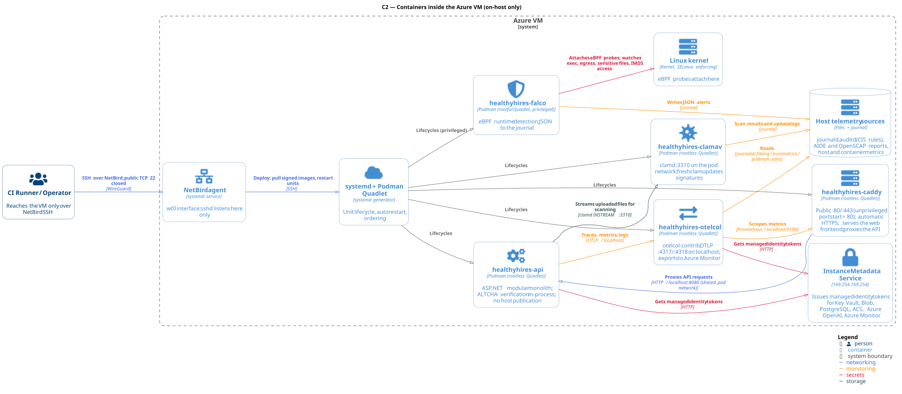

# Container / Deployment Architecture

**Scope:** This document describes what runs on the HealthyHires VM: the containers and host services, their ports, how Caddy terminates TLS, which connections the VM opens, and how configuration and secrets reach the workloads. Managed Azure services are described only as outbound dependencies; identity and credentials are covered in detail by [iam.md](iam.md).

**Conventions:** One Azure VM in one EU region ([ADR-001](ADR.md#adr-001-hosting-platform--azure-vm)) running AlmaLinux 10 ([ADR-015](ADR.md#adr-015-operating-system--almalinux-10)). Application containers are **rootless** Podman containers owned by a dedicated `healthyhires` service user and managed as systemd user units via Quadlet ([ADR-002](ADR.md#adr-002-container-runtime--podman-rootless-where-possible)). Falco is the only rootful, privileged container ([ADR-011](ADR.md#adr-011-runtime-container-security--falco)).

**Status:** design only; Quadlets, firewall rules and acceptance tests are not implemented yet. Open questions are collected in §5.



## 1. Runtime Components

### 1.0 The host

| Property | Value |
| -------- | ----- |
| VM | One Azure VM in Germany West Central (EU), AlmaLinux 10 Marketplace image configured by cloud-init |
| Public IP | Yes; DNS name is the application hostname (see §5) |
| Containers | `healthyhires-caddy`, `healthyhires-api`, `healthyhires-otelcol`, `healthyhires-clamav` (rootless, in one pod); `healthyhires-falco` (rootful) |
| Host services | `sshd` (NetBird interface only), `netbird`, `auditd`, AIDE and OpenSCAP timers, Azure Linux Agent (`waagent`), `chronyd` |
| Inbound from the internet | TCP 80 and 443 to Caddy only |
| Outbound to the internet | Direct (§2.2) |
| State | No business data. Only re-creatable state: Caddy certificates, ClamAV signatures, local logs |

All business data lives in managed services: PostgreSQL ([ADR-006](ADR.md#adr-006-primary-database--postgresql-managed)) and Blob Storage ([ADR-005](ADR.md#adr-005-object-storage--azure-blob-storage)). The VM can therefore be rebuilt from scratch without data loss (§4.4).

### 1.1 The application pod (`healthyhires`)

Caddy, the API, the Collector and ClamAV run in one rootless Podman pod. Containers in a pod share one network namespace, so they reach each other on `localhost`:

| Container | Listens on (inside the pod) | Published on the host |
| --------- | --------------------------- | --------------------- |
| `healthyhires-caddy` | `:80`, `:443`; metrics `localhost:9180` | `0.0.0.0:80`, `0.0.0.0:443` |
| `healthyhires-api` | `localhost:8080` | — |
| `healthyhires-otelcol` | `localhost:4317` (OTLP/gRPC), `localhost:4318` (OTLP/HTTP) | — |
| `healthyhires-clamav` | `localhost:3310` (clamd) | — |

Only the pod's ports 80 and 443 are published. Rootless containers cannot bind ports below 1024 by default, so the host sets `net.ipv4.ip_unprivileged_port_start=80`. Rootless networking uses `pasta`, which preserves the client's source IP for Caddy ([ADR-002](ADR.md#adr-002-container-runtime--podman-rootless-where-possible)).

Sharing a network namespace means every container can reach every other container's `localhost` ports. Caddy's admin API is therefore disabled (§1.2), and each service still authenticates or limits what it accepts.

### 1.2 Caddy (`healthyhires-caddy`)

- **Role:** the public edge and TLS terminator ([ADR-003](ADR.md#adr-003-edge--reverse-proxy--caddy)). It serves the React frontend, which is built into the Caddy image at `/srv`, and proxies `/api/*` to `localhost:8080`.
- **Configuration:** `configs_production/Caddyfile.production`, which imports the routes and headers from `configs_production/site.caddy`; both are built into the Caddy image at `/etc/caddy` together with the frontend (`deploy/caddy/Dockerfile`), so the signed image carries its configuration. The local `configs/caddy/Caddyfile` imports the same `site.caddy`, so the edge tested locally is the one deployed. The hostname, ACME contact, Blob Storage endpoint and the frontend's Entra settings come from `/etc/healthyhires/caddy.env`. The Caddy binary itself is rebuilt from the same release with a patched Go toolchain while the official 2.11.7 binary has open High findings (`deploy/caddy/Dockerfile`).
- **Routes:** `/api/*` and `/hubs/*` (SignalR, [ADR-A014](ADR-ASPNET.md#adr-a014-real-time-communication--signalr)) to the API; `/config.json` generated from the environment and never cached ([ADR-F013](ADR-FRONTEND.md#adr-f013-build-and-delivery--static-bundle-served-by-caddy)); hashed `/assets/*` cached for a year; every other path serves the frontend, with `index.html` for client-side routes.
- **Headers:** `nosniff`, `X-Frame-Options DENY`, `Referrer-Policy no-referrer`, HSTS and no `Server` header everywhere. The API's responses get a deny-all Content Security Policy; the frontend's allows only its own scripts, Entra ID for sign-in and Blob Storage for uploads. The frontend may be framed by its own origin (`frame-ancestors 'self'`, `X-Frame-Options SAMEORIGIN`): MSAL's silent token renewal loads it in a hidden iframe. Request bodies to `/api/*` are capped at 4 MB, since files never pass through the API.
- **Health endpoint:** proxies `/health` to `localhost:8080` as well, for the external availability tests ([ADR-016](ADR.md#adr-016-external-uptime-probe--application-insights-availability-tests)). `/alive` is not routed, so from the internet it falls through to the frontend like any unknown path.
- **Same origin:** the frontend and the API share one hostname, so the API needs no CORS configuration. CORS is configured only on Blob Storage, for direct browser uploads and downloads ([ADR-A010](ADR-ASPNET.md#adr-a010-file-storage--azure-blob-storage-via-azure-sdk)).
- **Certificates:** automatic HTTPS through Let's Encrypt (HTTP-01 / TLS-ALPN-01). The ACME account key and certificates live on the persistent volume `caddy-data`; losing it forces re-issuance and can hit Let's Encrypt rate limits.
- **Client IP:** Caddy sets `X-Forwarded-For` to the real client address and ignores any value sent by clients. The API trusts that header only from Caddy, for per-IP rate limiting of applicants ([ADR-A007](ADR-ASPNET.md#adr-a007-rate-limiting--aspnet-core-rate-limiting)).
- **Admin API:** disabled (`admin off`), because every container in the pod could otherwise reach it. Configuration changes are applied by restarting the container.
- **Telemetry:** Prometheus metrics on `127.0.0.1:9180/metrics`, scraped by the Collector; access and error logs as JSON to the journal, with query strings removed so tokens and search terms are not logged.
- **Credentials:** none.

### 1.3 ASP.NET API (`healthyhires-api`)

- **Image:** native container publish, framework-dependent, on `noble-chiseled-extra` ([ADR-A013](ADR-ASPNET.md#adr-a013-build-and-publish--native-container-publish-on-noble-chiseled)); no AOT, which the API-versioning and OpenAPI libraries do not support. Cosign-signed in CI ([ADR-008](ADR.md#adr-008-security--supply-chain-tools--trivy-openscap-aide-cosign)). Runs as the image's non-root user.
- **Listener:** `localhost:8080`, plain HTTP inside the pod; never published.
- **Health endpoints:** both return only the aggregate status (`Healthy`, `Degraded` or `Unhealthy`), never check names or error details.

  | Endpoint | Passes when | Reachable from | Used by |
  | -------- | ----------- | -------------- | ------- |
  | `/health` | Every check passes, including PostgreSQL and Blob Storage | The internet, through Caddy | Application Insights availability tests ([ADR-016](ADR.md#adr-016-external-uptime-probe--application-insights-availability-tests)) |
  | `/alive` | The process responds | Inside the pod only | Local liveness checks (§5) |

  `/health` must stay public: the availability tests run outside the VM, so they can reach the API only through DNS, TLS and Caddy, which is exactly the path they measure. `/alive` has no use outside the VM, because a dead process already fails `/health`.

  Each `/health` call queries PostgreSQL and Blob Storage, so the public path must not let anyone generate dependency load: the API caches the result for 10 seconds, whatever the status, query string or headers, and lets concurrent requests wait for one run instead of each running the checks (`HealthCheckCachePolicy` in `ServiceDefaults`); it also applies its per-IP rate limiter to the path ([ADR-A007](ADR-ASPNET.md#adr-a007-rate-limiting--aspnet-core-rate-limiting)). The availability tests call it a few times per five minutes, far below either limit.
- **Credentials:** none stored. Azure services are reached with the VM's managed identity, and the ALTCHA signing key is read from Key Vault at startup ([iam.md §4–§5](iam.md#4-workloads--the-vms-managed-identity)).
- **Talks to:** PostgreSQL, Blob Storage, Key Vault, ACS Email, Azure OpenAI and Entra ID (§2.2); ClamAV on `localhost:3310` to scan uploads; the Collector on `localhost:4317`.
- **Failure mode:** systemd restarts it. While it is down, Caddy answers `502` for API calls and keeps serving the frontend.

### 1.4 ClamAV (`healthyhires-clamav`)

- **Image:** upstream `clamav/clamav`, pinned by digest.
- **Listener:** clamd on `localhost:3310`; the API streams each confirmed upload to it (`INSTREAM`) without writing the file to disk.
- **Signatures:** `freshclam` inside the container updates them over HTTPS — the only egress Falco allows from this container ([ADR-011](ADR.md#adr-011-runtime-container-security--falco)). The database lives on the persistent volume `clamav-db`, so a restart does not re-download it.
- **Resources:** the signature database is held in memory and needs about 1–2 GB of RAM ([ADR-005](ADR.md#adr-005-object-storage--azure-blob-storage)). Loading it after a start takes up to a minute.
- **Failure mode:** while ClamAV is down or still loading, uploads stay in the "scanning" state and are retried; they never become visible to staff unscanned.

### 1.5 OpenTelemetry Collector (`healthyhires-otelcol`)

- **Image:** `otelcol-contrib`, pinned by digest ([ADR-007.1](ADR.md#adr-0071-telemetry-pipeline--opentelemetry-collector-otelcol-contrib)). The configuration file is versioned in git and mounted read-only.
- **Runs as:** root inside the `healthyhires` user namespace, with the user's supplementary groups and **without SELinux separation**, so it can read the journal export, the audit log and `/proc` (accepted in ADR-007.1).
- **Receivers:**
  - OTLP on `localhost:4317/4318` from the API;
  - Prometheus scrape of Caddy on `localhost:9180`;
  - `hostmetrics` from the host's `/proc` and `/sys`, mounted read-only;
  - `journald` (Falco, ClamAV, Caddy and host units) and `filelog` (auditd log, AIDE and OpenSCAP reports), mounted read-only;
  - `podman_stats` through the `healthyhires` user's Podman socket.
- **Exporter:** `azuremonitor` to Application Insights. How it authenticates is an open item (§5).
- **Failure mode:** the application keeps working; only telemetry is lost until systemd restarts the Collector. An Azure Monitor alert on missing data reports the gap.

### 1.6 Falco (`healthyhires-falco`)

- **Image:** upstream Falco, pinned by digest, with the rules file versioned in git.
- **Runs as:** a **rootful, privileged** system Quadlet — the one exception to rootless containers, because the modern eBPF probe needs kernel access.
- **Listeners:** none.
- **Watches:**
  - unexpected processes in the API container;
  - egress outside known destinations;
  - reads of sensitive files;
  - access to the Instance Metadata Service;
  - any egress from ClamAV other than `freshclam` HTTPS.
- **Output:** JSON on stdout → journal → Collector → Azure Monitor alerts.
- **Failure mode:** nothing is blocked either way; while Falco is down, detection is lost silently. Its absence in the telemetry raises an alert.

### 1.7 Host services

| Service | Purpose |
| ------- | ------- |
| `sshd` | Reachable only through the NetBird interface `wt0`, which firewalld puts in its own zone; public TCP 22 is closed ([ADR-014](ADR.md#adr-014-admin-access--netbird-operator-and-ci-runner-ssh)). Password logins are off, and the Serial Console `breakglass` user is denied over SSH |
| `netbird` | Admin mesh agent; a systemd service, not a container, so it works even if Podman does not |
| `auditd` | CIS audit rules with documented deviations ([ADR-017](ADR.md#adr-017-auditd-rule-scope--cis-baseline-with-documented-deviations)) |
| AIDE, OpenSCAP | systemd timers for file-integrity and CIS compliance checks; audit-only, never remediating ([ADR-008](ADR.md#adr-008-security--supply-chain-tools--trivy-openscap-aide-cosign)) |
| `waagent` | Azure Linux Agent: provisioning, extensions and Run Command |
| `chronyd` | Time synchronisation |

### 1.8 What does not run on the VM

- **The CI runner** builds, scans and signs images on GitHub-hosted runners ([C1 Supply Chain](../diagrams/architecture/C1_Supply_Chain.svg)) and reaches the VM only over NetBird SSH to deploy.
- **Managed services** — PostgreSQL, Blob Storage, Key Vault, ACS Email, Azure OpenAI, Azure Monitor and Entra ID. None of them connect to the VM; the VM connects to them (§2.2).
- **Browser file transfers** go directly from the browser to Blob Storage through short-lived SAS URLs and never pass through the VM ([ADR-A010](ADR-ASPNET.md#adr-a010-file-storage--azure-blob-storage-via-azure-sdk)).

## 2. Networking

### 2.1 Inbound listeners

These are the only host listeners. Adding another one requires an ADR.

| Host endpoint | Service | Exposure |
| ------------- | ------- | -------- |
| TCP `<public-ip>:80` | Caddy | Internet; ACME HTTP-01 and redirect to HTTPS |
| TCP `<public-ip>:443` | Caddy | Internet; the application |
| TCP `<netbird-ip>:22` | `sshd` | NetBird peers only |

The Network Security Group allows inbound TCP 80 and 443 from the internet and denies all other inbound traffic from the internet; TCP 22 is never opened. NetBird needs no inbound rule because its agent only dials out.

### 2.2 Outbound flows

| Source | Destination | Protocol | Authentication |
| ------ | ----------- | -------- | -------------- |
| API | Azure Database for PostgreSQL (private VNet access) | TCP 5432, TLS | Entra token for the managed identity |
| API | Blob Storage | HTTPS | Managed identity |
| API | Key Vault | HTTPS | Managed identity |
| API | ACS Email | HTTPS | Managed identity |
| API | Azure OpenAI in Sweden Central ([ADR-024](ADR.md#adr-024-cv-scoring--azure-openai-gpt-4o-sweden-central)) | HTTPS | Managed identity; key access is disabled |
| API | `login.microsoftonline.com` | HTTPS | None; public OIDC discovery and signing keys (JWKS) |
| Collector | Azure Monitor ingestion endpoint | HTTPS | Connection string or managed identity (§5) |
| API, Collector | Instance Metadata Service `169.254.169.254` | HTTP, link-local | None; returns managed identity tokens |
| ClamAV (`freshclam`) | ClamAV signature mirror (CDN) | HTTPS | None |
| Caddy | Let's Encrypt ACME API | HTTPS | ACME account key |
| Podman | GitHub Container Registry | HTTPS | Read token if the packages are private |
| `netbird` | NetBird management, signal and relay | TCP 443, UDP (STUN) | Setup key, then peer key |
| `dnf` | AlmaLinux mirrors | HTTPS | Package signatures |
| `waagent`, DNS | Azure platform address `168.63.129.16` | HTTP, DNS | None |

### 2.3 TLS posture

- **Browser → Caddy:** TLS with a Let's Encrypt certificate.
- **Inside the pod:** plain HTTP and OTLP on `localhost`; the traffic never leaves the network namespace.
- **VM → Azure services:** TLS everywhere. PostgreSQL enforces TLS connections, and the storage account accepts HTTPS only.
- **Browser → Blob Storage:** HTTPS with a SAS URL; CORS allows only the application origin.

```
browser ──TLS──▶ Caddy ──HTTP (localhost)──▶ API ──TLS──▶ PostgreSQL / Blob / Key Vault / ACS / Azure OpenAI
   │
   └──HTTPS + SAS URL──▶ Blob Storage (uploads and downloads)
```

## 3. Deployment Topology

### 3.1 The VM

- **Size:** start with a burstable B2s (2 vCPU, 4 GB RAM) and measure. ClamAV alone needs 1–2 GB, so move to B2ms (8 GB) if memory runs short.
- **Disk:** single-instance VM availability depends on the disk type. Premium SSD qualifies for Azure's 99.9 % single-VM SLA and Standard SSD for 99.5 %; both cover the 99 % target in [ADD §6.2](ADD.md#62-quality-attributes-with-measurable-targets).
- **Network:** one VNet with a subnet for the VM and a delegated subnet for PostgreSQL private access.
- **Provisioning:** declared in Bicep ([ADR-023](ADR.md#adr-023-infrastructure-as-code--bicep), [infrastructure-operations-architecture.md](infrastructure-operations-architecture.md)); AlmaLinux 10 Marketplace image plus cloud-init, which:
  - creates the `healthyhires` and `deploy` users;
  - enables linger for `healthyhires`;
  - sets the `ip_unprivileged_port_start` sysctl;
  - installs Podman, NetBird, auditd, AIDE and OpenSCAP.

### 3.2 Container layout

| Unit | Location | Runs as |
| ---- | -------- | ------- |
| `healthyhires.pod` (publishes 80/443) | `/etc/containers/systemd/users/<healthyhires-uid>/` | `healthyhires` (rootless) |
| `caddy.container`, `api.container`, `otelcol.container`, `clamav.container` | same, each with `Pod=healthyhires.pod` | `healthyhires` (rootless) |
| `caddy-data.volume`, `clamav-db.volume` | same | `healthyhires` (rootless) |
| `falco.container` | `/etc/containers/systemd/` | root (privileged) |

- **Startup:** the Quadlet generator turns these files into systemd services, so they start at boot and restart on failure. Linger lets the `healthyhires` user's services start without anyone logging in.
- **Image references:** every image is referenced by digest (`image@sha256:…`), never by a moving tag.

### 3.3 Deployment and rollback

1. **CI:** builds, scans and signs the images, then connects to the VM over NetBird SSH as `deploy`. That user's key is restricted to a forced deploy command ([iam.md §6](iam.md#6-ci-pipeline-identity)).
2. **Verify:** CI sends a release bundle (`deploy/render-bundle.sh`: Quadlet files with image digests, environment files, Collector configuration, Falco rules) on stdin. `hh-deploy` (`deploy/host/`) checks that every image is pinned by digest and verifies the Cosign signature of the `healthyhires` images against this repository's deploy workflow on `main`; the repository is fixed in `/etc/healthyhires/deploy.conf` at provisioning, not taken from the bundle. Verification failure stops the deploy.
3. **Activate:** the script installs the Quadlet and environment files, runs `systemctl --user daemon-reload` for the `healthyhires` user, and restarts the pod and Falco.
4. **Rollback:** `hh-deploy rollback` reinstalls the previous release, which the script keeps with the four before it. The operator runs it over SSH; the deploy key can trigger it too.

A restart briefly interrupts the service; zero-downtime updates are not a goal ([ADR-002](ADR.md#adr-002-container-runtime--podman-rootless-where-possible)).

## 4. Secrets and Configuration

### 4.1 Configuration

- **Non-secret files** (Quadlets, the Caddy configuration in `configs_production/`, Collector configuration, Falco rules) are versioned in git and copied to the VM by the deploy step.
- **Non-secret settings** (Key Vault URI, Blob endpoint, PostgreSQL host and login role, Entra tenant and client IDs) live in the GitHub environment `production`, are written into `/etc/healthyhires/*.env` by each deploy, and reach the containers through `EnvironmentFile=`.
- **No secret** is stored in git, in Quadlet files or in environment variables.

### 4.2 Secrets at runtime

The VM stores no secrets on disk. Workloads get managed identity tokens from the Instance Metadata Service and read the few remaining secrets from Key Vault at startup; the full inventory is in [iam.md §5](iam.md#5-secrets-inventory).

### 4.3 Boot order

1. Network and `chronyd`, then `netbird` and `sshd`, so administration works even if the application does not.
2. `auditd` and Falco (system services).
3. The `healthyhires` user manager (linger), which starts the pod: the Collector, ClamAV, the API and Caddy.
4. Caddy may answer `502` until the API is ready, and the API accepts uploads while ClamAV is still loading signatures (§1.4).

### 4.4 Rotation and rebuild

- **Key Vault secrets:** add a new secret version, then restart the consuming container, which reads secrets only at startup. Rotating the ALTCHA key invalidates challenges that are already open, which only affects forms submitted at that moment.
- **TLS certificates:** renewed automatically by Caddy.
- **Managed identity credential:** rotated by Azure.
- **Rebuild:** a lost VM is replaced by provisioning a new one and running a deploy. Caddy re-issues its certificates and ClamAV re-downloads its signatures. Logs already exported to Azure Monitor are kept; logs not yet exported are lost.

## 5. Open Items

- [x] **Hostname:** the free Azure DNS label `<label>.germanywestcentral.cloudapp.azure.com`, set in `infra/azure.env`; Bicep uses it for the Blob Storage CORS origin and the availability test, and it is the SPA redirect URI ([guide §4](../operations/azure-deployment-guide.md#4-register-the-app-in-the-company-entra-tenant)).
- [x] **Collector → Azure Monitor authentication:** connection string from Key Vault, read at every Collector start by `hh-podman-secret` with the managed identity and passed as a Podman secret. Entra authentication can replace it if the `azuremonitor` exporter gains support.
- [ ] **Collector file access (implemented, to verify):** the Collector runs as root in the user namespace with `GroupAdd=keep-groups`, `healthyhires` is in `adm` and `systemd-journal`, and auditd uses `log_group = adm` (`infra/cloud-init.yaml`, `deploy/quadlets/user/otelcol.container`). The journal is exported to a file by `hh-journal-export.service`, because the Collector image has no `journalctl`. Verify both against the CIS baseline on the VM.
- [ ] **Falco and rootless containers:** verify that Falco resolves the container names of the `healthyhires` user's rootless containers, so its rules can target the API and ClamAV.
- [ ] **IMDS restriction:** all pod containers share one network namespace and one Unix user, so IMDS cannot be blocked for ClamAV and Caddy alone. Decide whether to accept this or to split containers across service users with per-user firewall rules ([iam.md §4.3](iam.md#43-the-shared-identity-risk)).
- [ ] **VM size:** measure memory under load (k6, [ADR-018](ADR.md#adr-018-load-and-performance-testing--k6)) with ClamAV loaded and confirm B2s or move to B2ms.
- [ ] **API liveness check:** the `noble-chiseled` image has no shell or `curl`, so a Podman `HealthCmd` cannot call `/alive` from inside the container. Decide between a health-probe mode in the API binary itself and the Collector's `httpcheck` receiver probing `localhost:8080/alive` for alerting only.
- [ ] **Azure OpenAI settings in the release bundle:** `provision.sh github` already writes `OPENAI_ENDPOINT` and `OPENAI_DEPLOYMENT` to the GitHub environment, but `deploy/render-bundle.sh` and `.github/workflows/deploy.yml` do not pass them to the API container yet. Add them together with the CV scoring code ([ADR-024](ADR.md#adr-024-cv-scoring--azure-openai-gpt-4o-sweden-central)).
- [ ] **Cold start:** reboot the VM and confirm that every service comes back and the `502` window closes without intervention.
