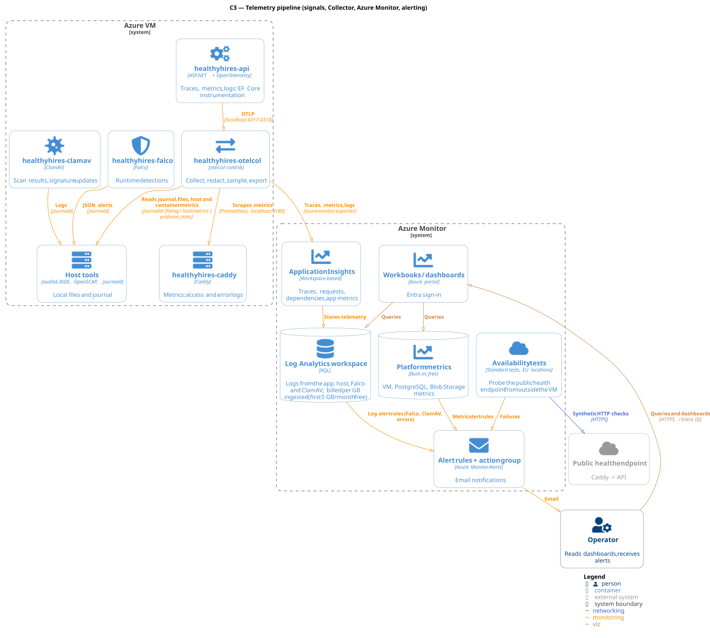

# Observability Architecture

**Scope:** how telemetry is produced, collected, exported, stored, correlated and alerted on — for the API, the VM and the tools running on it. It covers the Collector pipeline, how Azure Monitor shapes everything downstream, how the [ADD §6.2](ADD.md#62-quality-attributes-with-measurable-targets) targets are measured, and how a user-reported error reaches its trace.

It does **not** cover: the Collector's container, listeners and failure handling as a workload — [container-deployment.md §1.5](container-deployment.md#15-opentelemetry-collector-healthyhires-otelcol); the identities and role assignments behind each export — [iam.md](iam.md); provisioning the Azure Monitor resources — [infrastructure-operations-architecture.md](infrastructure-operations-architecture.md); local development telemetry beyond §13 — [aspire-dev-stack.md](aspire-dev-stack.md).

**Conventions:** OpenTelemetry for instrumentation, Azure Monitor as the backend ([ADR-007](ADR.md#adr-007-observability--azure-monitor--opentelemetry)); telemetry leaves the VM only through the Collector ([ADR-007.1](ADR.md#adr-0071-telemetry-pipeline--opentelemetry-collector-otelcol-contrib)). The API never talks to Azure Monitor itself.

**Status:** design; the API's instrumentation and redaction exist in code, the Collector configuration and alert rules are not written yet. Open questions are collected in §16.

## 1. What Is Observed

One distinction organises this document: **inside-out** telemetry, where the system reports on itself, and **outside-in**, where something outside the VM reports on it. Everything below is inside-out except the availability tests (§8.3). When the VM is down, inside-out telemetry goes silent rather than red, which is why the one outside-in check matters more than any amount of internal instrumentation.

The producers:

- **The ASP.NET API** — traces, metrics and redacted logs over OTLP ([ADR-A009](ADR-ASPNET.md#adr-a009-telemetry--opentelemetry-with-ef-core-integration)).
- **Caddy** — Prometheus metrics, and JSON access and error logs to the journal ([container-deployment.md §1.2](container-deployment.md#12-caddy-healthyhires-caddy)).
- **ClamAV** — scan and signature-update logs to the journal.
- **Falco** — runtime detections as JSON to the journal ([ADR-011](ADR.md#adr-011-runtime-container-security--falco)).
- **Host tools** — `auditd` ([ADR-017](ADR.md#adr-017-auditd-rule-scope--cis-baseline-with-documented-deviations)), AIDE and OpenSCAP reports ([ADR-008](ADR.md#adr-008-security--supply-chain-tools--trivy-openscap-aide-cosign)), selected journal units, host and container metrics.
- **Azure platform** — VM, PostgreSQL and Blob Storage platform metrics and the Activity log, which Azure collects without anything on the VM (§4.1).
- **Availability test** — a synthetic check from one EU location against the public `/health` ([ADR-016](ADR.md#adr-016-external-uptime-probe--application-insights-availability-tests)).

**Entra ID sign-in and audit logs** are deliberately not in this list: on the Free tier they stay in Entra for 7 days and cannot be exported to Log Analytics (§12).

## 2. The Telemetry Pipeline

### 2.1 Receivers

One Collector, `otelcol-contrib`, runs in the application pod ([ADR-007.1](ADR.md#adr-0071-telemetry-pipeline--opentelemetry-collector-otelcol-contrib)). Its receivers:

| Receiver | Source | Notes |
| -------- | ------ | ----- |
| `otlp` | The API, on `localhost:4317/4318` | The only receiver that listens; it is never published outside the pod |
| `prometheus` | Caddy on `localhost:9180`, and the Collector's own metrics | Every 60 s |
| `filelog/journal` | The journal, exported as JSON lines by `hh-journal-export.service` (the Collector image has no `journalctl`), filtered to an **allowlist**: Falco, ClamAV, Caddy, `sshd`, `sudo`, `netbird`, `waagent` | Not the whole journal — most units are noise that is billed per GB |
| `filelog` | `auditd` log, AIDE and OpenSCAP reports | Mounted read-only |
| `hostmetrics` | Memory, filesystem and load from `/proc` and `/sys` | CPU, network and disk I/O come free from the platform (§4.1) |
| `podman_stats` | The `healthyhires` user's containers | Per-container CPU and memory |

How a rootless Collector gets read access to the journal and the audit log is open in [container-deployment.md §5](container-deployment.md#5-open-items).

### 2.2 Processing

Order matters:

`memory_limiter` → `resource` → `filter` → `batch`

- `memory_limiter` first, so back-pressure applies before work is done on records that may be dropped.
- `resource` stamps the attributes in §2.3 on everything the Collector collects itself.
- `filter` drops Caddy access-log lines for `/health`: the availability tests call it at a fixed rate, and those lines are pure ingestion cost.
- **Sampling** is not enabled (§7); the Collector is where it will go.

**Redaction happens at the source, not here.** The API erases classified log arguments before any provider sees them (§6), and Caddy strips query strings from its access log. The Collector adds no PII scrubbing of its own: a transform cannot reliably sanitise exception messages, stack traces or `auditd` command lines, so those streams are treated as potentially sensitive instead (§12).

### 2.3 Resource attributes

`service.name`, `service.version` and `deployment.environment` make a signal attributable and are what Application Insights shows as the **cloud role** (`cloud_RoleName`). Each source has exactly one authority for them:

| Source | Set by | `service.name` |
| ------ | ------ | -------------- |
| API | `OTEL_SERVICE_NAME` and `OTEL_RESOURCE_ATTRIBUTES` in `/etc/healthyhires/api.env`, written by each deploy with the commit as `service.version` | `healthyhires-api` |
| Everything the Collector collects | The Collector's `resource` processor, per pipeline | `caddy`, `clamav`, `falco`, `host` |

The code sets none of them: there is no `ConfigureResource` call. Locally the AppHost injects them; on the VM `deploy/render-bundle.sh` writes them, and without them every API signal would arrive as `unknown_service`.

### 2.4 Export to Azure Monitor

The Collector exports everything with the `azuremonitor` exporter to one **workspace-based Application Insights** resource, which stores its data in a Log Analytics workspace. Signals land in these tables:

| Signal | Table | Queried for |
| ------ | ----- | ----------- |
| Server spans | `AppRequests` | Request rate, failures, latency |
| Client spans (PostgreSQL, Blob Storage, Key Vault, HTTP) | `AppDependencies` | Dependency failures and latency |
| Exceptions recorded on spans or logs | `AppExceptions` | Error triage |
| Logs — the API's **and** everything from `journald` and `filelog` | `AppTraces` | Falco detections, ClamAV, host and audit records |
| Metrics | `AppMetrics` | Application, Caddy, host and container metrics |
| Availability test results | `AppAvailabilityResults` | §8.3, §9 |

One consequence is easy to miss: **host, Falco and audit records share `AppTraces` with application logs**, told apart only by `cloud_RoleName` (§2.3). Every query and alert on them filters on it first.

The exporter authenticates with the connection string, which Bicep stores in Key Vault and the VM reads at every Collector start with its managed identity ([iam.md §5](iam.md#5-secrets-inventory)).

### 2.5 Failure modes

- **Collector down.** The API is unaffected; all telemetry stops until systemd restarts the Collector. Nothing reports the gap by itself, so a missing-data alert does (§8.4).
- **Azure Monitor unreachable.** The exporter retries from an in-memory queue. A long outage or a Collector restart loses what was queued; telemetry is not business data, so this is accepted.
- **VM down.** Every inside-out signal stops at once. Only the availability tests (§8.3) and the platform metrics (§4.1) still say anything.

## 3. Host and Security-Tool Telemetry

The tools from [ADR-008](ADR.md#adr-008-security--supply-chain-tools--trivy-openscap-aide-cosign), [ADR-011](ADR.md#adr-011-runtime-container-security--falco) and [ADR-017](ADR.md#adr-017-auditd-rule-scope--cis-baseline-with-documented-deviations) come in two kinds, and the kind decides the alert:

- **Continuous streams** — `auditd`, Falco and the journal produce records as things happen. Their failure mode is too much, not too little: volume is the cost.
- **Periodic reports** — AIDE and OpenSCAP run on systemd timers and produce one report per run. Their first failure mode is **silence**, so each needs an alert on a missing report as well as on its result (§8.4).

Two points shape the design:

- **Every legitimate change produces AIDE findings** until the baseline is re-taken, so re-taking it is routine — and therefore a good place for an attacker to hide. A baseline update is made only after the operator has explained the differences ([infrastructure-operations-architecture.md §5.2](infrastructure-operations-architecture.md#52-what-gets-updated-and-how)).
- **OpenSCAP evaluates the tailored CIS Level 1 Server profile.** Both tools run daily (`hh-openscap.timer`, `hh-aide.timer`) and append a one-line JSON summary — for OpenSCAP the counts of `fail`, `error` and `notchecked` results, which §9 measures — to a file the Collector exports. The full reports stay on the VM for two weeks for the rule-level detail.

`auditd` runs the CIS rule set with documented deviations, and its records count toward the ingestion bill ([ADR-017](ADR.md#adr-017-auditd-rule-scope--cis-baseline-with-documented-deviations)). It is the largest and least predictable log source on the VM; its volume must be measured before production (§16).

## 4. Azure Monitor as the Backend

### 4.1 What Azure collects without us

Some telemetry costs nothing and needs nothing on the VM. It is the first place to look, and what the Collector does not duplicate:

| Source | What | Cost |
| ------ | ---- | ---- |
| VM platform metrics | CPU, network, disk I/O | Free, 93 days |
| PostgreSQL Flexible Server platform metrics | CPU, memory, storage, connections | Free, 93 days |
| Storage account platform metrics | Transactions, availability, capacity | Free, 93 days |
| Activity log | Control-plane operations on every resource: who changed what in Azure | Free, 90 days |

**Resource logs** (diagnostic settings) are different: they are billed by ingestion like everything else. Only one is enabled initially — **Key Vault `AuditEvent`**, because secret and key access is security evidence and its volume is tiny. PostgreSQL and Blob Storage resource logs stay off until a question needs them.

Alert rules can use platform metrics directly, so a free metric is still a metric to alert on (§10).

### 4.2 Retention

Kept at the included defaults: **90 days for the Application Insights tables, 30 days for the rest of the workspace, 93 days for platform metrics**. Longer retention is charged per GB per month. Because everything the Collector exports lands in Application Insights tables (§2.4), host and audit records are kept 90 days too.

Nothing here needs to be kept for years. ADR-007's cost lever is ingestion, not retention, so retention stays at the defaults.

### 4.3 Access

Telemetry is read in the Azure portal — Application Insights, Log Analytics queries (KQL) and Workbooks — with the operator's Entra account ([iam.md §7](iam.md#7-operator-access-paths)). Access to telemetry is access to the Azure subscription; there is no separate dashboard login to manage. Workbooks that are kept are declared in Bicep with the rest of the monitoring resources ([ADR-023](ADR.md#adr-023-infrastructure-as-code--bicep)).

## 5. Metrics

Instrumented today: ASP.NET Core, HttpClient and .NET runtime metrics; the Npgsql and Blob Storage client integrations add their own. **No module meter exists yet** — they are added in `ServiceDefaults` as modules define them.

Naming: `healthyhires.<module>.<noun>`, with the unit in the instrument, not the name.

**The cardinality budget matters more than the volume.** A metric's cost and query speed depend on how many distinct attribute combinations it has. Allowed as attributes: bounded values — module, status class, outcome, HTTP method. Forbidden: user id, application id, file id, trace id, route values, anything unbounded.

The first module metrics worth adding, because §9 needs them:

- **Upload scan duration** — from upload confirmation to the ClamAV verdict, as a histogram. The upload-processing target cannot be measured without it.
- **Uploads waiting for a scan** — a gauge, so a ClamAV outage shows up as a growing queue rather than as silence.

## 6. Logs

The API logs through `Microsoft.Extensions.Logging` with source-generated `[LoggerMessage]` methods, and the OpenTelemetry logging provider exports the formatted message and scopes. Each message has an `EventId` and an `EventName` (`host.request.unhandled_exception`, `host.request.unstorable_text`).

- **Classification:** personal and sensitive arguments are marked `[PersonalData]` or `[SensitiveData]` (`Kernel.Telemetry`). Both map to `ErasingRedactor`, and an unknown future classification is erased too, so logging fails closed ([ADR-A009](ADR-ASPNET.md#adr-a009-telemetry--opentelemetry-with-ef-core-integration)). Redaction runs before the console, journal and OTLP providers see a value.
- **Paths:** errors log the **route template**, never the request path, because a path carries ids and applicant-supplied values.
- **Exceptions:** redaction does not rewrite exception messages or stack traces, so `AppExceptions` and error records are treated as potentially containing personal data.
- **Levels:** `Information` by default and `Warning` for `Microsoft.AspNetCore`, from `appsettings.json`; changed per environment through the Quadlet environment, not by rebuilding.

## 7. Traces

Instrumented today: ASP.NET Core (with `/health` and `/alive` filtered out in code), HttpClient, and the Npgsql and Blob Storage client integrations, which register their own sources. Npgsql records the parameterised SQL without parameter values, so database spans do not leak values by default.

ADR-A009 calls for **EF Core instrumentation**. EF Core is not in the API yet; when it is added, its integration replaces the plain Npgsql one and must keep parameter values out of spans.

**No application code creates spans yet.** A trace currently shows the HTTP request and its database and storage calls and nothing in between. Custom spans pay off around upload confirmation, scanning and e-mail sending, where work happens outside a single request.

**Sampling is off.** Every trace is exported: at about 20 staff users plus applicants the volume is small, and a full baseline is the most useful thing to have first. The trigger to change it is volume, not a date — when trace ingestion approaches the free 5 GB/month, enable **tail sampling** in the Collector: keep every failed trace, every slow one, and a fraction of the rest. Head sampling would drop errors at the same rate as successes. Enabling it is an ADR at that point.

## 8. Health and Availability Monitoring

### 8.1 The endpoint contract

`/health` runs every check — PostgreSQL, Blob Storage and `self` — and is public through Caddy, cached for 10 seconds and rate limited. `/alive` runs only the `self` check tagged `live` and is reachable only inside the pod. ClamAV and Mailpit/ACS are deliberately not health checks: the application stays available without them. Details in [container-deployment.md §1.3](container-deployment.md#13-aspnet-api-healthyhires-api).

### 8.2 Inside-out

How `/alive` is probed on the VM is open: the `noble-chiseled` image has no shell for a Podman health command, and the alternatives are a probe mode in the API binary or the Collector's `httpcheck` receiver ([container-deployment.md §5](container-deployment.md#5-open-items)).

Whichever is chosen, one rule applies to every inside-out signal: **a dead process produces no data, not failing data.** A threshold alert on a value never fires when the thing being measured has stopped existing. Every inside-out signal that matters therefore needs a **missing-data** alert alongside any threshold alert.

### 8.3 Outside-in

An Application Insights standard availability test calls `https://<hostname>/health` every 15 minutes from one EU location (West Europe) ([ADR-016](ADR.md#adr-016-external-uptime-probe--application-insights-availability-tests)). They are the only check that sees DNS, TLS, Caddy and the whole VM, and the only one still working when the VM is down.

The test retries a failed run once before counting it, and the alert fires on a counted failure. One location keeps the per-run cost down; the price is that a network problem at the probe's own location looks like an outage, which the operator recognises when the site still works. Sign-in is not probed: Entra ID MFA blocks scripted logins.

### 8.4 Monitoring the monitors

Three things fail silently, and each needs its own missing-data alert:

- **The Collector** — no `AppMetrics` rows from `host` for 15 minutes means the whole pipeline is down.
- **Falco** — no detections is the normal state, so absence of detections proves nothing. Falco's periodic metrics snapshot is enabled as a heartbeat, and its absence alerts.
- **AIDE and OpenSCAP** — a report that does not arrive within its timer interval plus a margin.

## 9. Measuring the Targets

The targets belong to [ADD §6.2](ADD.md#62-quality-attributes-with-measurable-targets) and are not restated here; this section owns how each is computed.

| Target | Computed from |
| ------ | ------------- |
| Application availability | `AppAvailabilityResults`: the share of test runs that pass, per month. Not from inside-out checks — the target is availability to a user, not liveness of a process |
| P95 API latency | `AppRequests` duration, split into reads (`GET`, and read-only `POST` queries from [ADR-A015](ADR-ASPNET.md#adr-a015-read-only-endpoints-with-a-request-body--post-now-query-later)) and writes by method and route template — never per URL |
| Upload processing | The upload scan duration histogram from §5; **not measurable until it exists** |
| Security (OpenSCAP) | The latest OpenSCAP report's `fail`, `error` and `notchecked` counts after tailoring (§3) |
| Cost discipline | The Cost Management budget ([infrastructure-operations-architecture.md §7](infrastructure-operations-architecture.md#7-ownership-and-monitoring)) and workspace ingestion (§14) |

Availability is reported monthly in a Workbook. Staff sign-in availability is not measured, because it is not probed (§8.3).

## 10. Alerting

### 10.1 Rule types

Azure Monitor has several rule types, and the choice decides both what a rule can see and what it costs:

| Type | Evaluates | Cost | Used for |
| ---- | --------- | ---- | -------- |
| Availability test alert | Test results | Included with the test | §8.3 |
| Metric alert | Platform and Application Insights metrics | Per monitored time series | Thresholds on CPU, storage, failures |
| Log search alert | A KQL query on the workspace | Per rule, more for shorter intervals | Falco, missing data, report results |
| Activity log alert | Control-plane events | Free | Changes to role assignments, NSG rules and locks |

Every alert rule is declared in Bicep, so the rule set is reviewed like code ([ADR-023](ADR.md#adr-023-infrastructure-as-code--bicep)). Log search alerts run every 15 minutes unless a faster response is worth the price.

### 10.2 Severity and delivery

Two levels, distinguished by what the operator does, not by how bad it sounds:

- **Act** (Azure Sev 1) — look at it as soon as it is read: the service is down, or a security tool fired.
- **Review** (Azure Sev 3) — look at it in the next maintenance window.

Both go by **e-mail** through one action group to the operator. There is no on-call rota and no paging; response is best effort ([infrastructure-operations-architecture.md §7](infrastructure-operations-architecture.md#7-ownership-and-monitoring)). No alert triggers an automated action such as a restart: systemd already restarts failed units, and anything beyond that needs a person.

### 10.3 Initial alert set

Kept deliberately small, so every alert is one the operator acts on:

| Alert | Type | Severity |
| ----- | ---- | -------- |
| Availability test failing after its retry | Availability | Act |
| API failure rate (5xx share of `AppRequests`) above threshold | Log search | Act |
| Any Falco detection of priority `Warning` or higher | Log search | Act |
| Collector silent for 15 min (§8.4) | Log search | Act |
| Falco heartbeat missing (§8.4) | Log search | Act |
| OpenSCAP report with failures, or missing | Log search | Review |
| AIDE report with unexplained changes, or missing | Log search | Review |
| VM filesystem above 85 % | Log search on `hostmetrics` | Review |
| PostgreSQL storage above 80 % | Metric | Review |
| Workspace ingestion above the daily threshold (§14) | Log search | Review |
| Role assignment, NSG rule or resource lock changed | Activity log | Review |

The Activity log alert is also the drift signal between maintenance windows ([infrastructure-operations-architecture.md §6.2](infrastructure-operations-architecture.md#62-drift)).

## 11. Correlation

Every error response is a `ProblemDetails` with a `traceId` extension — the current W3C trace id (`ProblemDetailsTelemetry` in the API). In Application Insights that is the `operation_Id`, so a user's error report leads straight to the request, its dependencies, its exceptions and its log lines.

Beyond that handle: logs carry the trace and span ids of the request that wrote them, and everything joins on `cloud_RoleName` from §2.3 — which is why missing resource attributes are a correlation problem, not only a labelling one.

## 12. Audit Trails and Where They Land

| Source | Lands in | Kept | Notes |
| ------ | -------- | ---- | ----- |
| `auditd` | `AppTraces`, `cloud_RoleName = host` | 90 days | Command lines can contain personal data ([ADR-017](ADR.md#adr-017-auditd-rule-scope--cis-baseline-with-documented-deviations)) |
| Falco detections | `AppTraces`, `cloud_RoleName = falco` | 90 days | The detection path that alerts |
| `sshd`, `sudo`, `netbird` journal units | `AppTraces`, `cloud_RoleName = host` | 90 days | Who logged in to the VM and what they ran with `sudo` |
| Azure Activity log | Azure, not the workspace | 90 days | Who changed what in the subscription; free |
| Key Vault `AuditEvent` | Log Analytics | 30 days | Every secret and key access |
| Entra ID sign-in and audit logs | Entra ID only | **7 days** | Entra ID Free cannot export them; read in the Entra admin center |
| Application audit trail (who did what to an application) | — | — | Not designed yet; belongs to the data architecture |

**The 7-day Entra window is the weakest link.** A suspicious staff sign-in has to be noticed within a week or its record is gone. Exporting sign-in logs needs Entra ID P1, a paid licence the project does not have; this is accepted for a school project and stated rather than assumed away.

Telemetry that may contain personal data — exceptions, `auditd` command lines, journal records — is never copied out of the workspace and is kept no longer than the default retention.

## 13. Environments

| Environment | Where telemetry goes |
| ----------- | -------------------- |
| Local | The Aspire dashboard; the AppHost injects `OTEL_EXPORTER_OTLP_ENDPOINT` and the resource attributes ([aspire-dev-stack.md §3](aspire-dev-stack.md#3-how-the-api-consumes-the-stack)). No Collector, no Azure Monitor |
| Rehearsal | Its own Application Insights and workspace in the rehearsal resource group, deleted with it ([infrastructure-operations-architecture.md §2](infrastructure-operations-architecture.md#2-region-and-environments)) |
| Production | The Collector on the VM, exporting to Application Insights |

The API exports only when `OTEL_EXPORTER_OTLP_ENDPOINT` is set (`ServiceDefaults`). On the VM the Quadlet file sets it to the Collector, along with the resource attributes from §2.3.

## 14. Cost and Volume Control

Azure Monitor bills per GB ingested, with the first 5 GB per month free ([ADR-007](ADR.md#adr-007-observability--azure-monitor--opentelemetry)). The levers, in the order they should be pulled:

1. **Drop what is never read** — `/health` access logs (§2.2), journal units outside the allowlist (§2.1), and host metrics the platform already provides for free (§4.1). Pure saving, no loss.
2. **Keep attributes bounded** — the cardinality rule in §5.
3. **Tune `auditd`** — the largest unpredictable source; deviations from the CIS set are recorded in ADR-017's process, not made silently.
4. **Tail sampling** on traces, at the trigger in §7.

A **daily cap** on the workspace is not used: when it is reached, ingestion stops for the rest of the day, including Falco detections and audit records. A Review alert on daily ingestion (§10.3) warns before cost becomes a problem instead.

Alert rules and availability tests are billed too; they are part of the monthly budget, not free extras.

## 15. Deferred and Out of Scope

- **Client-side telemetry** — browser errors and performance from the React app. Not designed; it would need its own ADR for the SDK and the personal-data question.
- **CI/CD pipeline telemetry** — build duration, failure rate, deploy frequency. GitHub Actions' own history covers it for now.
- **Long-term audit archive** — not needed for a school project; §12 states what is kept and for how long.

## 16. Open Items

- [ ] **Collector file access:** implemented, to be verified on the VM ([container-deployment.md §5](container-deployment.md#5-open-items)).
- [ ] **`/alive` probe:** probe mode in the API binary or the Collector's `httpcheck` receiver (§8.2).
- [ ] **Upload metrics:** add the scan-duration histogram and the waiting-uploads gauge (§5); the upload-processing target cannot be measured until then.
- [ ] **EF Core instrumentation:** when EF Core is added, use its Aspire integration and confirm that parameter values stay out of spans (§7).
- [ ] **`auditd` volume:** measure GB per day with the CIS rule set on the real VM before production, and set the ingestion alert threshold from it (§3, §14).
- [ ] **Thresholds:** set the API failure-rate threshold and alert intervals after a month of production telemetry, together with the ADD §6.2 baselines.
