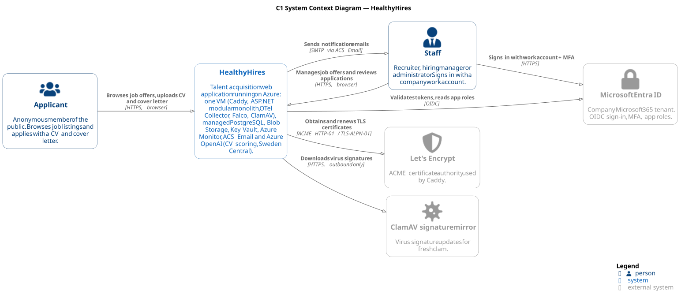
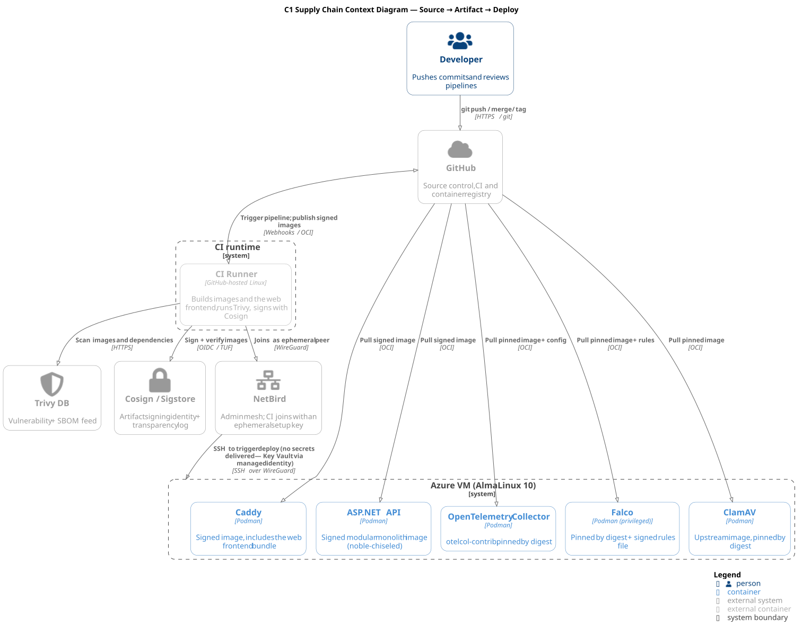

# System Context View

> **View:** C1 — System Context.
> **Purpose:** Show HealthyHires from the outside — who uses it, what it depends on, and where trust changes hands.

## 1. Scope of this View

This view answers three questions only:

1. Who are the human actors?
2. Which external systems does HealthyHires interact with, and over what protocols?
3. Where do trust boundaries cross?

Containers, ports and host details are in [container-deployment.md](container-deployment.md); identities and credentials are in [iam.md](iam.md).

## 2. Actors

| Actor | Authentication | Concerns |
| ----- | -------------- | -------- |
| **Applicant** | None — anonymous member of the public | Browses open job offers and applies with a CV and cover letter. |
| **Recruiter** | Entra ID work account, app role `Recruiter` | Publishes job offers, reviews applications and works with candidates. |
| **Hiring Manager** | Entra ID work account, app role `HiringManager` | Reviews the candidates for positions in their team. |
| **Administrator** | Entra ID work account, app role `Admin` | Manages the application; full access to the company's hiring data. |
| **Platform Operator** | Personal Azure, GitHub and NetBird accounts | Deploys releases, administers the VM, watches alerts, handles incidents. |

> **Note:** Staff accounts are pre-created by the company in Entra ID; there is no self-registration ([ADR-004](ADR.md#adr-004-identity-provider--microsoft-entra-id-oidc)). The exact permissions of each staff role are still to be defined ([iam.md §2.3](iam.md#23-roles-and-claims)). Today, all operator roles are one person.

### 2.1 Explicitly out of scope as actors

- **Other companies** — HealthyHires serves a single company; there is no multi-tenancy.
- **Mobile and desktop users** — the application is used only through web browsers ([ADD §2](ADD.md#2-purpose)).
- **Applicant accounts** — applicants never sign in, so they have no identity or session to manage.

## 3. External Systems

Every system listed here is outside the HealthyHires VM. The Owner column is the internal role that holds the relationship ([ADD §4](ADD.md#4-stakeholders-and-concerns)).

### 3.1 Runtime externals

| External system | Protocol we use | Why we depend on it | Decision record | Owner | Cost |
| --------------- | --------------- | ------------------- | --------------- | ----- | ---- |
| **Microsoft Entra ID** | OIDC (browser redirects); HTTPS for discovery and signing keys | Staff sign-in, MFA, app roles; managed identity tokens for the VM | [ADR-004](ADR.md#adr-004-identity-provider--microsoft-entra-id-oidc) | `@auth` | Included in Microsoft 365 / free tier |
| **Azure Database for PostgreSQL** | TCP / SQL over TLS, private VNet access | Primary relational store, one schema per module | [ADR-006](ADR.md#adr-006-primary-database--postgresql-managed) | `@data` | Pay-as-you-go (smallest burstable tier) |
| **Azure Blob Storage** | HTTPS (Blob API, SAS URLs) | CVs, cover letters and backups; browsers upload and download directly | [ADR-005](ADR.md#adr-005-object-storage--azure-blob-storage), [ADR-A010](ADR-ASPNET.md#adr-a010-file-storage--azure-blob-storage-via-azure-sdk) | `@platform` | Pay-as-you-go, low |
| **Azure Key Vault** | HTTPS | The few remaining secrets and the KEKs | [ADR-012](ADR.md#adr-012-secrets-store--azure-key-vault), [ADR-013](ADR.md#adr-013-key-management-kek--azure-key-vault) | `@security`, `@platform` | Per operation, low |
| **Azure Communication Services Email** | HTTPS (ACS Email SDK); delivery events via Event Grid | Notification emails | [ADR-010](ADR.md#adr-010-email-delivery--azure-communication-services-email) | `@platform` | Per email, low |
| **Azure OpenAI** (`gpt-4o`, Sweden Central) | HTTPS (Azure OpenAI chat completions) | Scores CVs against the role's requirements as an aid for HR; never rejects | [ADR-024](ADR.md#adr-024-cv-scoring--azure-openai-gpt-4o-sweden-central) | `@platform` | Per token, about €0.02–0.03 per CV |
| **Azure Monitor** (Application Insights + Log Analytics) | HTTPS (Azure Monitor exporter) | Traces, metrics, logs, alerts and external availability tests | [ADR-007](ADR.md#adr-007-observability--azure-monitor--opentelemetry), [ADR-016](ADR.md#adr-016-external-uptime-probe--application-insights-availability-tests) | `@obs` | First 5 GB/month free, then per GB |
| **Let's Encrypt** | ACME over HTTPS | TLS certificates for Caddy | [ADR-003](ADR.md#adr-003-edge--reverse-proxy--caddy) | `@platform` | Free |
| **ClamAV signature mirror** | HTTPS, outbound only | Virus signature updates for ClamAV | [ADR-005](ADR.md#adr-005-object-storage--azure-blob-storage), [ADR-011](ADR.md#adr-011-runtime-container-security--falco) | `@security` | Free |
| **NetBird** | WireGuard + managed control plane | Admin mesh for operator and CI SSH; opens no inbound port | [ADR-014](ADR.md#adr-014-admin-access--netbird-operator-and-ci-runner-ssh) | `@platform`, `@security` | Free tier |
| **OpenTelemetry Collector** (on the VM) | OTLP on `localhost` | Local telemetry gateway in front of Azure Monitor | [ADR-007.1](ADR.md#adr-0071-telemetry-pipeline--opentelemetry-collector-otelcol-contrib) | `@obs`, `@devops` | — |
| **Falco** (on the VM) | eBPF / kernel probes | Runtime detection; alerts, never blocks | [ADR-011](ADR.md#adr-011-runtime-container-security--falco) | `@security`, `@devops` | — |
| **ClamAV** (on the VM) | clamd on `localhost:3310` | Malware scanning of uploaded files before staff can open them | [ADR-A010](ADR-ASPNET.md#adr-a010-file-storage--azure-blob-storage-via-azure-sdk) | `@security` | — |

> **Note on the on-VM rows (Collector, Falco, ClamAV):** these run on our own VM and are not external systems in the strict sense. They are listed because the trust-boundary picture is incomplete without them: the Collector is the only path to Azure Monitor, Falco watches the other containers, and ClamAV decides when an untrusted file becomes visible to staff.

### 3.2 CI/CD and source-control externals

| External system | Protocol we use | Why we depend on it | Decision record | Owner |
| --------------- | --------------- | ------------------- | --------------- | ----- |
| **GitHub** | git / HTTPS / OCI | Source control, GitHub Actions CI and the container registry (GHCR) | [ADR-008](ADR.md#adr-008-security--supply-chain-tools--trivy-openscap-aide-cosign) | `@devops` |
| **Sigstore** (Cosign) | HTTPS / OIDC | Keyless image signing and its public transparency log | [ADR-008](ADR.md#adr-008-security--supply-chain-tools--trivy-openscap-aide-cosign) | `@security` |
| **Trivy vulnerability database** | HTTPS | Vulnerability data for image and dependency scans | [ADR-008](ADR.md#adr-008-security--supply-chain-tools--trivy-openscap-aide-cosign) | `@security` |

> **Why these are separate:** the runtime C1 diagram shows the system in production. The build and release path is shown in the [supply chain diagram](../diagrams/architecture/C1_Supply_Chain.svg) and its identities in [iam.md §6](iam.md#6-ci-pipeline-identity).

## 4. Trust Boundaries

A trust boundary is crossed when **data changes class** (public ↔ authenticated ↔ privileged) or **authority changes** (user ↔ service ↔ vendor).

### 4.1 Runtime trust boundaries

| # | Boundary | What crosses it | Why it matters |
| --- | -------- | --------------- | -------------- |
| TB-1 | **Internet ↔ Caddy** | All inbound browser traffic, TLS on TCP 443 (80 only for ACME and redirects) | The only network path into the VM. There is no CDN or WAF in front ([ADR-003](ADR.md#adr-003-edge--reverse-proxy--caddy)); the NSG allows only 80 and 443 ([container-deployment.md §2.1](container-deployment.md#21-inbound-listeners)). |
| TB-2 | **Caddy ↔ ASP.NET API** | Plain HTTP on `localhost` inside the pod; `X-Forwarded-For` set by Caddy | The API trusts the client IP only because Caddy sets it. Pod membership is not caller identity; the API still authenticates staff ([container-deployment.md §1.1](container-deployment.md#11-the-application-pod-healthyhires)). |
| TB-3 | **Anonymous applicant ↔ application endpoints** | Untrusted form data from the public internet | Public data becomes stored data. Protected by ALTCHA, per-IP rate limiting and validation ([ADR-022](ADR.md#adr-022-bot-protection--altcha-on-the-application-form), [ADR-A007](ADR-ASPNET.md#adr-a007-rate-limiting--aspnet-core-rate-limiting), [iam.md §3](iam.md#3-applicants--anonymous-access)). |
| TB-4 | **Browser ↔ Blob Storage** | File uploads and downloads with short-lived SAS URLs | Files bypass the VM entirely. A SAS URL is a bearer capability: scoped to one blob and one permission, valid for minutes, never logged ([ADR-A010](ADR-ASPNET.md#adr-a010-file-storage--azure-blob-storage-via-azure-sdk)). |
| TB-5 | **Uploaded file → ClamAV → staff** | An untrusted file from an anonymous applicant | The file stays hidden until ClamAV reports it clean; infected files are deleted. This is where an applicant's file becomes something staff may open. |
| TB-6 | **Staff browser ↔ Entra ID ↔ API** | OIDC sign-in with PKCE; JWT access tokens on API calls | Identity is established by Entra; the API validates tokens locally against Entra's signing keys and authorizes by app role. Disabled users keep access until their token expires, at most ~90 minutes ([iam.md §2.2](iam.md#22-sign-in-and-token-lifecycle)). |
| TB-7 | **Workloads ↔ Instance Metadata Service** | Managed identity tokens for Azure services | Every container on the VM can request the VM's tokens; the main mitigations are narrow role assignments and Falco ([iam.md §4.3](iam.md#43-the-shared-identity-risk)). |
| TB-8 | **API ↔ PostgreSQL** | Parameterised SQL over TLS, private VNet, Entra token instead of a password | Business data boundary; each module touches only its own schema ([ADR-A001](ADR-ASPNET.md#adr-a001-application-architecture--modular-monolith)). |
| TB-9 | **API ↔ Blob Storage** | Blob API calls and user delegation keys for SAS URLs, with managed identity | The API decides who gets a SAS URL; Blob Storage enforces it. |
| TB-10 | **API ↔ Key Vault** | Secrets read at startup; wrap/unwrap of data keys | KEKs never leave the vault ([ADR-013](ADR.md#adr-013-key-management-kek--azure-key-vault)). |
| TB-11 | **API ↔ ACS Email; Event Grid → API** | Outbound emails; inbound delivery-status events | Inbound events reach the API through Caddy from the internet, so the webhook must authenticate its caller (§6). |
| TB-12 | **API ↔ Azure OpenAI** | Text extracted from scanned CVs and the role's requirements; scores with quoted evidence back | Applicant data leaves the VM for a model; a Standard deployment processes it only in Sweden Central, and the API treats the reply as untrusted, advisory output ([ADR-024](ADR.md#adr-024-cv-scoring--azure-openai-gpt-4o-sweden-central)). |
| TB-13 | **Collector ↔ Azure Monitor** | Traces, metrics and logs over HTTPS | Logs may contain personal data from applications; the API redacts at the source. |
| TB-14 | **ClamAV ↔ signature mirror** | Signature downloads, outbound HTTPS only | Third-party data that decides what counts as malware; Falco alerts on any other egress from ClamAV. |
| TB-15 | **Operator / CI ↔ VM** | SSH over NetBird on the `wt0` interface only | Admin access boundary; public TCP 22 is closed. Azure Serial Console is the out-of-band break-glass path ([ADR-014](ADR.md#adr-014-admin-access--netbird-operator-and-ci-runner-ssh)). |
| TB-16 | **Operator ↔ Azure portal / Entra admin center** | Control-plane operations: resources, role assignments, users | The highest-impact boundary: compromise of the operator's Azure account means full control ([iam.md §7](iam.md#7-operator-access-paths)). |

### 4.2 Supply-chain trust boundary

| # | Boundary | What crosses it | Why it matters |
| --- | -------- | --------------- | -------------- |
| TB-17 | **GitHub ↔ CI runner ↔ GHCR ↔ VM** | Reviewed source → scanned, Cosign-signed images → digest-pinned deployment | The VM runs only images whose signature or digest it has verified; the deploy user can only run the deploy command ([container-deployment.md §3.3](container-deployment.md#33-deployment-and-rollback)). |

## 5. Data Flows

Each entry points to the document that owns the detail; this list is for navigation.

### 5.1 Staff authentication (every staff session)

Staff browser → Entra ID sign-in (MFA) → back to the React app with tokens → API calls with `Authorization: Bearer`.

- MSAL.js runs the authorization-code flow with PKCE; the SPA has no secret.
- The API validates every token locally against Entra's signing keys; it never calls Entra per request.
- Detail: [iam.md §2](iam.md#2-staff-users--microsoft-entra-id).

### 5.2 Job browsing (anonymous, hot path)

Applicant browser ↔ Caddy ↔ API ↔ PostgreSQL.

- The React frontend and the API share one hostname, so no CORS is needed for the API.
- Read-only endpoints are rate limited per IP like every anonymous call.

### 5.3 Application submission and file upload

1. The browser solves an ALTCHA challenge and asks the API for an upload URL, stating file size and type.
2. The API checks that the job offer is open, validates size and type, and returns a write-only SAS URL.
3. The browser uploads the file directly to Blob Storage.
4. The browser confirms the upload; the API checks the blob's real size and type and streams it to ClamAV.
5. Clean files become visible to staff; infected or mismatched files are deleted. Unconfirmed uploads are deleted after an hour.

Detail: [ADR-A010](ADR-ASPNET.md#adr-a010-file-storage--azure-blob-storage-via-azure-sdk).

### 5.4 CV scoring

API → Blob Storage (clean CV) → text extraction in the API → Azure OpenAI → score and evidence stored in PostgreSQL.

- Runs in the background after ClamAV clears the file, so submitting an application never waits for the model; if Azure OpenAI is unavailable, the application is saved and scored later.
- The model returns a verdict with quoted evidence for each requirement; the overall score is computed by the API, and staff make every decision ([ADR-024](ADR.md#adr-024-cv-scoring--azure-openai-gpt-4o-sweden-central)).

### 5.5 Staff review and file download

Staff browser ↔ Caddy ↔ API ↔ PostgreSQL; for files, API → read-only SAS URL → browser ↔ Blob Storage.

- The API authorizes every download by role before issuing a SAS URL valid for a few minutes.

### 5.6 Telemetry

API, Caddy, ClamAV, Falco and host logs → OpenTelemetry Collector → Azure Monitor; Application Insights availability tests → public health endpoint.

- Detail: [C3 Telemetry Pipeline](../diagrams/architecture/C3_telemetry_pipeline.svg), [ADR-007.1](ADR.md#adr-0071-telemetry-pipeline--opentelemetry-collector-otelcol-contrib).

### 5.7 Email

API → ACS Email → recipient; ACS → Event Grid → API for delivery status.

- Bounces and failed deliveries are recorded so staff can see that a notification did not arrive ([ADR-010](ADR.md#adr-010-email-delivery--azure-communication-services-email)).

### 5.8 Backup

PostgreSQL automated backups with point-in-time restore inside Azure; exported backups encrypted with a KEK and stored in Blob Storage.

- Detail: `backup-recovery-plan.md` (TODO).

### 5.9 Maintenance traffic

Caddy ↔ Let's Encrypt for certificates; ClamAV ↔ signature mirror for updates; VM ↔ GHCR for image pulls during deploys.

## 6. Open Items

- **Q-1 (Hostname)** — Azure DNS label or an own domain; it decides the TLS certificate, the SPA redirect URI and the Blob Storage CORS origin ([container-deployment.md §5](container-deployment.md#5-open-items)).
- **Q-2 (Event Grid webhook authentication)** — ACS delivery events arrive from the internet through Caddy. Decide how the API verifies that a call really comes from Event Grid before enabling the webhook.
- **Q-3 (Applicant emails)** — The context diagram shows notification emails to staff only. Decide whether applicants receive a confirmation email; if so, applicant email addresses become a delivery target with bounce handling.
- **Q-4 (Realtime transport)** — SignalR runs inside the API ([ADR-A014](ADR-ASPNET.md#adr-a014-real-time-communication--signalr)) and is therefore not an external system. Mentioned to answer "where is SignalR in C1?".
- **Q-5 (Infrastructure provisioning)** — Decided: every Azure resource and role assignment is declared in Bicep under `infra/` ([ADR-023](ADR.md#adr-023-infrastructure-as-code--bicep)).
